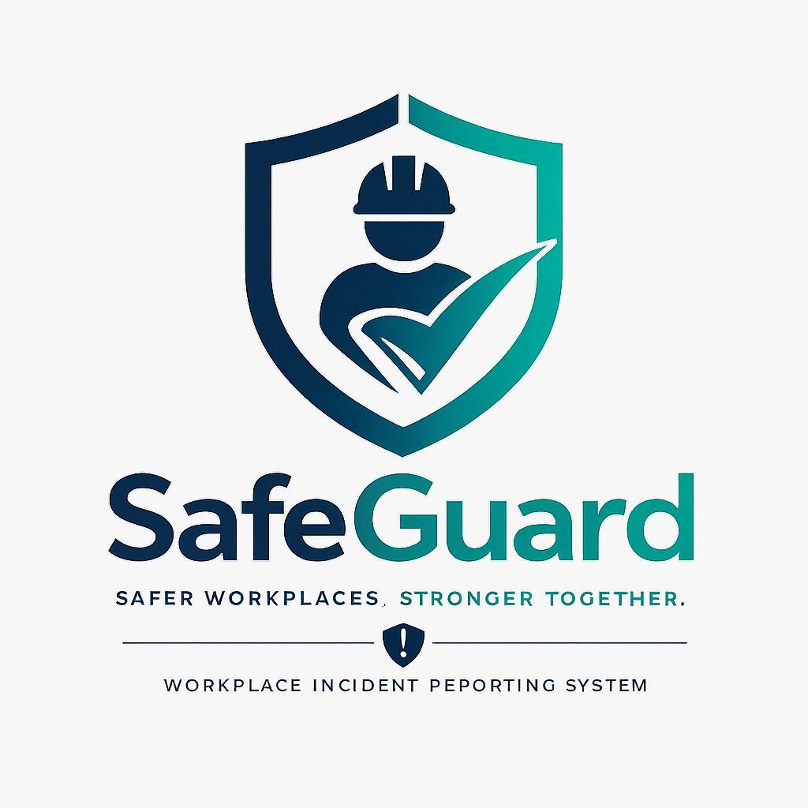

# SafeGuard: Employee Safety, Incident and Compliance Management Platform

SafeGuard is a ServiceNow platform for end-to-end workplace safety management, built as Team Lead of Team Momentum for RiseUp with ServiceNow on instance dev425137. It covers incident and near-miss reporting, investigations, corrective action tracking, risk assessment, inspections, PPE and training requests, an AI assistant layered across both portals, a live safety map with department QR codes, and Slack alerts for high and critical incidents.

I designed it around a real question: what happens to a hazard between the moment it's noticed and the moment it's actually fixed. Most of the build makes that gap visible and accountable, rather than letting it live in one person's memory. I kept the data model deliberately separated by concern (an incident is a fact, a corrective action is a task, an approval only exists where a real decision is being made) rather than forcing every workflow through one generic pattern.

## What it does

- Lets employees report an Incident, Hazard, Dangerous Occurrence, or Near Miss through a short guided form, and calculates a Risk Rating automatically from Likelihood x Severity via a decision table.
- Routes incidents needing investigation to a safety manager, tracks investigation status, and raises a Corrective Action automatically when one is required.
- Tracks every Corrective Action through to completion, with automated overdue detection.
- Supports five additional request types through the Service Catalog: Risk Assessment, Safety Inspection, Safety Consultation, PPE Request, and Training.
- Sends a full notification lifecycle by email for serious incidents, corrective action assignment, investigation assignment, training expiry, high-risk near misses, and corrective action completion.
- Runs a daily overdue sweep and a weekly training compliance check (60-day and 30-day warnings, plus expiry), and a monthly summary report.
- Posts a Slack alert to a dedicated safety channel for every high or critical incident, so safety managers are notified straight away.
- Presents two distinct portals from the same data: an Employee Portal for reporting and tracking, and a Management Portal for oversight, approvals, and KPIs.
- Plots incidents, near misses, and risk assessments on a Safety Map, colour-coded and role-filtered, with nine department QR codes that open a quick-report page pre-filled for that department.
- Runs an AI assistant, built on Google Gemini, present on both portals and on individual forms, scoped separately for employees and managers.

## Data model

8 core tables, plus reference data for 9 departments, 8 locations, and 3 incident types (Incident, Hazard, Dangerous Occurrence). Full table list and relationships in [`docs/data-model.md`](docs/data-model.md).

| Table | Purpose |
|---|---|
| Safety Incident | Incidents, hazards, dangerous occurrences, and investigations |
| Near Miss Report | Close calls, with likelihood and severity |
| Corrective Actions | Actions raised from investigations and near misses |
| Risk Assessment | Documented workplace risks |
| Safety Inspection Request | Employee requests for inspections |
| Safety Consultation Request | Requests for safety advice |
| PPE Request | Protective equipment requests |
| Training Record | Certifications, expiry, and results |

## Automation

Full build in [`docs/architecture.md`](docs/architecture.md) and [`docs/workflow.md`](docs/workflow.md).

**Flows**

| Flow | Purpose |
|---|---|
| S1 Send Safety Notification (subflow) | Reusable email sender |
| S2 Close Overdue Records (subflow) | Reusable overdue closer |
| F1a Incident Created | Acknowledges reporter, notifies manager, flags investigation for high severity |
| F1b Incident Updated | Investigation status, corrective action creation, completion notices |
| F2 Daily Overdue Check | Daily 8am overdue sweep |
| F3 Near Miss Handler | Notification, high-risk escalation, investigation alerts |
| F4 Training Compliance Monitor | Weekly 60-day and 30-day warnings, plus expiry |
| F5 Monthly Safety Report | Monthly summary to leadership |

**Other automation**

- Decision Table: SR Risk Rating Matrix (20 rows, likelihood by severity)
- 3 Business Rules: automatic risk status, investigation required flag, training status
- 2 Scheduled Jobs: daily status check, weekly training summary
- 6 Email Notifications: serious incident, corrective action assigned, investigation assigned, training expired, high-risk near miss, corrective action completed
- 4 Client Scripts: incident type helper, corrective action section control, near miss risk calculator, severity trigger
- Slack alert to a safety channel for every high or critical incident, via Incoming Webhook

## Security

- 6 roles: `sg_admin`, `sg_safety_manager`, `sg_manager`, `sg_hr`, `sg_employee`, `sg_executive`
- 12 ACLs covering create, read, write, and delete on the three core tables, plus list-page-level access rules

## Service Catalog

- Category: Safety and Compliance
- **Report Something**: Report an Incident, Report a Near Miss
- **Request Something**: Risk Assessment, Safety Consultation, Safety Inspection, PPE Request, Training
- Each backed by its own Record Producer

## Employee Portal (`safeguard_employee`)

- Navy-to-teal branding with a shield logo
- Home page: hero banner, three action buttons, QR code widget, recent reports, FAQ, footer
- Time-based greeting (morning/afternoon/evening)
- My Reports page with tabs
- Navigation bar widget with dropdown menus
- Nine department QR codes, each linking to a quick-report page (`sg_quick_report?department=`) pre-filled for that department, with emergency numbers 999 and 111 shown

## Management Portal (`safeguard_management`)

- KPI summary cards, recent incidents, overdue actions
- Card widget linking to Incident Management, Near Miss, Corrective Actions, Training, PPE, Risk, Consultation, Inspections, and the Dashboard
- Footer links to the Employee Portal and Safety Dashboard
- Sub-menu card design per module (e.g. Incidents: All, Open, Overdue, Create New)
- Manager list pages with in-portal approve/reject for PPE, Risk, Inspection, and Consultation requests

## Safety Map

- Map page plotting Incidents (red), Near Misses (yellow), and Risk Assessments (blue)
- Hardcoded coordinates for the 8 locations near Salford, since internal room names cannot be geocoded
- Role-based filtering, surfaced as a Safety Locations Map module (order 900)

## AI Assistant

Built on Google Gemini, server-side only. Full details in [`docs/architecture.md`](docs/architecture.md).

| Component | Role |
|---|---|
| SafeGuard Gemini AI (REST Message) | Connection and API key, server-side only |
| SafeGuardAIService (Script Include) | System prompt, role rules, temperature 0.2, response cleaning |
| SG AI Assistant Button | Floating employee assistant: Report, Request, Emergency, Guidance |
| SG Manager AI Assistant | Floating manager assistant with live table queries and guidance |
| SafeGuard Form AI Assistant | Floating "Need help with this form?" helper on individual forms |

## Tested scenarios

| Scenario | Evidence | Status |
|---|---|---|
| New incident created, acknowledgement and manager notification sent | `screenshots/TC01-incident-created` | Pending capture |
| High-severity incident auto-flags investigation required | `screenshots/TC02-high-severity-flag` | Pending capture |
| Corrective action created on investigation outcome | `screenshots/TC03-corrective-action-creation` | Pending capture |
| Near miss escalation on high risk rating | `screenshots/TC04-near-miss-escalation` | Pending capture |
| High or critical incident posts an alert to the Slack safety channel | `screenshots/TC05-slack-incident-alert` | Pending capture |
| Training compliance reminders fire at 60/30 days and on expiry | `screenshots/TC06-training-compliance` | Pending capture |
| Daily overdue check flags a lapsed corrective action | `screenshots/TC07-overdue-check` | Pending capture |
| Department QR code opens a pre-filled quick report | `screenshots/TC08-qr-quick-report` | Pending capture |
| Safety Map plots and filters by role | `screenshots/TC09-safety-map` | Pending capture |
| Employee AI Assistant answers a reporting question | `screenshots/TC10-ai-employee-assistant` | Pending capture |
| Manager AI Assistant returns a live table query result | `screenshots/TC11-ai-manager-assistant` | Pending capture |

Folder naming and screenshot conventions are in [`screenshots/README.md`](screenshots/README.md).

I checked generated email records in the Personal Developer Instance Outbox. This project does not claim delivery to external mailboxes beyond Slack, where webhook delivery was verified directly.

## Technology

- ServiceNow Personal Developer Instance (dev425137)
- ServiceNow Studio / App Engine
- Flow Designer, Decision Tables, Subflows, Business Rules, Scheduled Jobs, Client Scripts
- Service Catalog, Record Producers
- Service Portal, custom widgets across Employee and Management portals
- Scripted REST API, Slack Incoming Webhooks
- Google Gemini via REST Message, Script Include-based AI service layer
- Roles, ACLs, and application scope security

## Project notes

- All people, locations, and submitted reports are fictional sample data.
- It is a portfolio project, not a production deployment.
- Scoped application limitations encountered and worked around: `addActiveQuery`, `addMonths`, and `getFields` are blocked in this scope.
- Corrective Action's table name carries a trailing "s" (`x_snc_safeguard_corrective_actions`); real field names across the app carry no `u_` prefix. PPE, Inspection, and Consultation requests all use a field literally named `status`.
