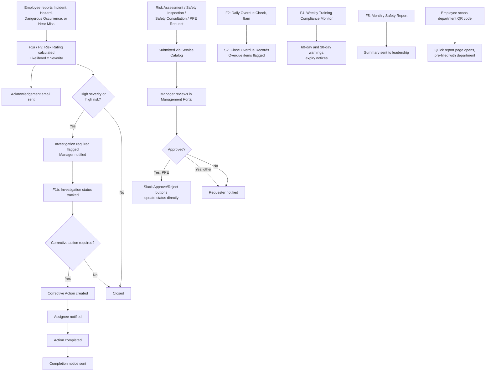

# SafeGuard Workflow

This mirrors the actual flow set built in Flow Designer: F1a and F1b split incident creation from incident updates, F3 handles Near Miss, F2/F4/F5 are scheduled, and S1/S2 are shared subflows called from every handler.
